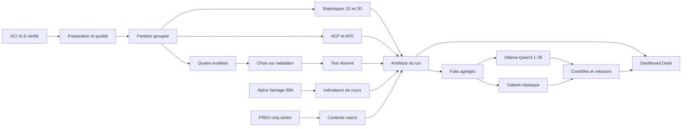

# Rapport BC2 — Analyse du défaut bancaire et IA générative

Version PDF complète (14 pages, avec figures) : [rapport-bc2-thomas-gassmann.pdf](../output/pdf/rapport-bc2-thomas-gassmann.pdf).

## Besoin

Un analyste risques veut comprendre quels clients font défaut, comparer des méthodes de détection, mesurer leurs erreurs et présenter les résultats à des conseillers et des managers. Le score reste une aide à l’analyse : aucune décision de crédit n’est automatisée.

| Source | Exigences |
|---|---|
| Sujet, partie 1 (C3.1–C4.3) | Préparation et typage, analyses 1D et 2D (Pearson, Spearman, Chi², ANOVA, t-test), ACP/AFD, régression logistique comparée à d’autres modèles, métriques adaptées, surapprentissage, écoresponsabilité, tableaux de bord inclusifs |
| Sujet, partie 2 (C3.2–C3.3) | Extraction de cotations, indicateurs sur plusieurs périodes, dashboards par profil, tendances et corrélations |
| Sujet, partie 3, facultative (C5.1–C5.3, C4.1) | Cas d’usage génératif, prototype avec un LLM, évaluation comparée à un script classique, feuille de route d’intégration |
| Sujet, conclusion | Synthèse, stratégie d’intégration de l’IA, impact stratégique |

**Choix des données** : le dataset de référence du sujet n’étant pas disponible, le projet utilise UCI Default of Credit Card Clients, un dataset public de référence en risque de crédit. La cible devient le défaut de paiement du mois suivant au lieu de la résiliation : la démarche demandée (préparation, statistiques, ACP/AFD, comparaison de modèles, tableaux de bord) reste identique.

## Données

| Élément | Valeur |
|---|---|
| Source | UCI Default of Credit Card Clients, I-Cheng Yeh, licence CC BY 4.0, DOI 10.24432/C55S3H |
| Taille | 30 000 clients, 23 variables explicatives, historiques d’avril à septembre 2005 |
| Défauts | 6 636, soit 22,12 % |
| Variables du modèle | 14 quantitatives et 7 catégorielles ; `SEX` et `MARRIAGE` exclues du score, gardées pour l’audit descriptif |

Le fichier source est vérifié par empreinte SHA-256 et jamais modifié. Chaque variable a un type informatique et un type statistique (quantitative, nominale, ordinale). Les anomalies sont comptées et gardées, pas supprimées : 345 codes d’études inconnus regroupés en `unknown_code`, 54 valeurs `MARRIAGE=0`, montants de facture négatifs (un solde créditeur est possible), 35 lignes identiques hors identifiant.

## Architecture

Python 3.12, pandas, SciPy et scikit-learn suffisent pour 30 000 lignes : pas de cluster ni de base serveur. Tout tourne dans Docker Compose, sans service payant. Chaque run écrit ses résultats datés dans `exports/<run>/` ; un run existant n’est jamais écrasé.

## Méthode sans fuite

Les profils identiques sont gardés dans le même lot ([partition groupée](dictionnaire.md#partition-groupée)) : 18 000 lignes d’apprentissage, 6 000 de validation, 6 000 de test. Toutes les transformations (imputation, standardisation, encodage) sont apprises sur l’apprentissage seulement. Le modèle et son seuil sont choisis sur la validation, puis le choix est enregistré avant de calculer le test. Il n’y a pas de date par client : ce n’est donc pas une validation temporelle.

## Résultats statistiques

- **Analyse 1D** : moyenne, médiane, variance, quartiles, histogrammes et boxplots sur les 18 000 lignes d’apprentissage. Les montants sont très asymétriques.
- **Analyse 2D** : [Pearson et Spearman](dictionnaire.md#pearson-et-spearman) entre variables quantitatives (les factures de mois voisins sont fortement liées) ; [Chi²](dictionnaire.md#chi-deux) entre catégories, publié seulement si les effectifs attendus sont suffisants ; [test de Welch et ANOVA](dictionnaire.md#welch-et-anova) pour comparer des moyennes. La correction de [Benjamini-Hochberg](dictionnaire.md#benjamini-hochberg) limite les fausses découvertes. Exemple : l’âge moyen ne diffère pas significativement entre clients en défaut ou non (p ajustée 0,431), ce qui ne prouve pas l’absence de tout effet.
- **Réduction de dimension** : l’[ACP](dictionnaire.md#acp) résume les 14 variables quantitatives ; 8 composantes gardent 90 % de la variance. L’[AFD](dictionnaire.md#afd) a un seul axe, car il n’y a que deux classes.

## Modèles

| Test réservé (6 000 clients) | AP | ROC-AUC | Précision | Rappel | F1 |
|---|---|---|---|---|---|
| Constante (témoin) | 0,221 | 0,500 | 0,221 | 1,000 | 0,362 |
| Régression logistique | 0,544 | 0,765 | 0,353 | 0,760 | 0,482 |
| Arbre de décision | 0,507 | 0,760 | 0,253 | 0,949 | 0,400 |
| **Forêt aléatoire (retenue)** | 0,547 | 0,780 | 0,342 | 0,807 | 0,480 |

La forêt est choisie sur la validation par l’[average precision](dictionnaire.md#average-precision), avec un [seuil](dictionnaire.md#seuil-et-f2) de 0,15 qui privilégie le rappel. Sur le test : 1 071 défauts détectés, 256 manqués, 2 063 fausses alertes. Un [bootstrap](dictionnaire.md#bootstrap) donne un rappel entre 78,8 % et 82,5 % (intervalle à 95 %).

- **Surapprentissage** : l’AP de la forêt passe de 0,639 en apprentissage à 0,563 en validation ; profondeur et taille minimale des feuilles le limitent sans le supprimer.
- **Alternative** : la logistique est presque aussi bonne (AP 0,544) et plus simple. Le gagnant n’est pas changé après avoir vu le test.
- **Écoresponsabilité** : temps d’entraînement mesurés de 0,8 s (constante) à 6,3 s (forêt), ainsi que le temps CPU et la mémoire. L’énergie est estimée à partir de ces mesures avec la méthode [Green Algorithms](dictionnaire.md#green-algorithms) (temps CPU × puissance par cœur, plus la mémoire), sur le processeur du poste (Intel Core i9-9980HK, 45 W pour 8 cœurs) et l’intensité carbone moyenne du réseau français en 2025 (19,6 g CO₂e/kWh, RTE). C’est une estimation, pas une mesure par wattmètre (`docs/evidence/energy/estimate-20261123.json`).

| Étape | Énergie estimée | CO₂e estimé |
|---|---|---|
| Entraînement et validation croisée des quatre modèles | 0,032 Wh | 0,0006 g |
| Run complet (borne haute : deux threads occupés pendant 39 s) | 0,12 Wh | 0,0024 g |
| Une synthèse générée par le LLM local (borne haute : processeur entier à 45 W) | 0,21 Wh | 0,004 g |

Une seule synthèse LLM coûte environ 6,6 fois l’entraînement de tous les modèles, tandis que le gabarit répond en moins d’une milliseconde : c’est un argument de sobriété pour réserver le LLM aux textes qui en ont besoin. Ne sont pas comptés : la machine virtuelle Docker, l’écran, le repos et la fabrication du matériel.
- **Équité** : rappel de 83,2 % pour un sexe et 78,9 % pour l’autre. C’est une observation descriptive, pas un audit d’équité.

Preuves : `docs/evidence/pipeline/baseline-20261120-v2/models.json`, `docs/evidence/pipeline/reproduction.json`.

## Données financières et macro-économiques (partie 2)

**Cotations** : 100 séances IBM (juillet à novembre 2026) via l’API de démonstration Alpha Vantage. Indicateurs : base 100, rendements, [volatilité annualisée](dictionnaire.md#volatilité-annualisée), [drawdown](dictionnaire.md#drawdown). Sur la période, le cours brut baisse de 21,79 % et le drawdown maximal atteint −32,78 %. Yahoo Finance (erreur 429) et Stooq (vérification anti-robot) n’ont pas pu être utilisés, sans contournement. La clé de démonstration ne donne accès qu’à IBM : il n’y a donc pas de comparaison entre plusieurs titres.

**Contexte macro-économique** : cinq séries publiques de la Réserve fédérale ([FRED](dictionnaire.md#fred)) situent la période de la cohorte (avril à septembre 2005) dans un historique long, sans jointure avec les clients.

| Série | Moyenne avril–sept. 2005 | Rang de 2005 dans l’historique |
|---|---|---|
| Retards de paiement sur cartes, banques US | 3,79 % | 49 % (niveau médian) |
| Pertes sur cartes, banques US | 4,30 % | 61 % |
| Taux d’intérêt des cartes | 12,63 % | 27 % |
| Dollar taïwanais pour 1 USD | 31,83 | 60 % |
| Taux d’État US à 10 ans | 4,19 % | 32 % |

La cohorte n’a pas été observée en période de crise du crédit américain. Les variations trimestrielles des retards et des pertes sont corrélées à 0,47 (Spearman, 127 trimestres). Preuve : `docs/evidence/macro/fred-20261123.json`.

## Tableau de bord

Le dashboard Dash local présente : filtres par segment et par âge, tables exactes à côté de chaque graphique, statistiques et projections, comparaison des modèles, cotations, contexte macro, synthèse générée. Trois vues par profil (direction, risques, analyse de données) adaptent le message ; ce ne sont pas des droits d’accès.

Accessibilité vérifiée dans Chromium : navigation clavier, lien d’évitement, vue mobile 390 px, exports CSV des données des graphiques, aucune violation détectée par axe sur le parcours testé. Ce n’est pas un audit WCAG complet. Preuves : `docs/evidence/browser/`.

## IA générative (partie 3)

Cas d’usage : rédiger une synthèse des résultats pour un conseiller, à partir de faits agrégés seulement (aucun identifiant ni ligne client). [Ollama](dictionnaire.md#ollama) exécute localement Qwen3 1.7B (licence Apache 2.0, empreinte vérifiée). La réponse doit suivre un format JSON ; les chiffres, le HTML et certaines formulations sont refusés, car les chiffres restent affichés par le logiciel.

| Méthode | Cas réservés | Contrôles réussis | Durée |
|---|---|---|---|
| Gabarit classique | 2 | 2 | Quasi instantané |
| LLM, température 0,1 | 2 | 2 | 12,6 à 21,8 s (avec la 0,4) |
| LLM, température 0,4 | 2 | 2 | idem |
| Revue humaine | — | Non réalisée | — |

Les premiers essais (version 1 du contexte) ont été refusés car ils contenaient des chiffres ; le contexte a été réécrit sur un cas de développement distinct. Une réponse validée contient une formulation ambiguë (« modèle validé, non testé ») : les contrôles automatiques ne garantissent pas le sens. Conclusion : le gabarit suffit quand le texte peut être fixe ; le LLM apporte de la souplesse, au prix de la lenteur et d’une relecture obligatoire.

## Stratégie d’intégration de l’IA (C4.1)

| Étape proposée | Condition de passage |
|---|---|
| Cadrage | Accord sur les données et la finalité, rôles risques/DPO/sécurité définis |
| Validation externe | Données récentes autorisées, lots temporels, coûts réels des erreurs, audit d’équité, calibration |
| Pilote supervisé | Charge de revue humaine acceptable, procédure de contestation, formation des utilisateurs |
| Service contrôlé | Accès, supervision, retour arrière testé et approuvé |

Impact : l’outil aide à comprendre et prioriser, il ne remplace pas la décision. Le coût principal est la revue des fausses alertes (2 063 sur 6 000 clients au seuil choisi). Une dérive des données doit déclencher une revue, pas un réentraînement automatique. Ces étapes sont proposées ; aucune réunion avec des parties prenantes n’a eu lieu.

## Limites

| Limite | Conséquence |
|---|---|
| Données de 2005, sans date par client | Aucune garantie sur des clients actuels ; pas de validation temporelle |
| Une seule action cotée | Pas de comparaison entre titres |
| Revue humaine des textes générés et du dashboard non réalisée | Clarté et inclusivité non évaluées par des utilisateurs |
| Dashboard sans authentification ni HTTPS | Démonstration locale uniquement |
| Énergie estimée, pas mesurée par capteur | Ordre de grandeur seulement ; VM Docker et écran non comptés |

## Correspondance RNCP

| Compétence | Réalisation | Statut |
|---|---|---|
| C3.1 Préparation | Contrat de données, dictionnaire, règles de qualité, lots disjoints | Vérifié |
| C3.2 Visualisation | Dashboard interactif, filtres, vues par profil, accessibilité testée | Vérifié ; revue utilisateurs à faire |
| C3.3 Analyse | Tests statistiques avec hypothèses, correction multiple, contexte macro | Vérifié |
| C4.1 Cas d’usage IA | Coûts des erreurs, feuille de route | Proposé ; validation par parties prenantes à obtenir |
| C4.2 Modélisation | Quatre modèles, pipeline sans fuite, code testé | Vérifié |
| C4.3 Évaluation | AP, ROC-AUC, F1, précision, rappel, matrice, bootstrap, ressources et énergie estimée | Vérifié ; arbitrage à valider par parties prenantes |
| C5.1 Usages génératifs | Synthèse de faits agrégés comparée à un gabarit | Vérifié ; validation métier à obtenir |
| C5.2 Prototype | LLM local, erreurs gérées, intégré au dashboard | Vérifié ; utilité à valider |
| C5.3 Évaluation générative | Contrôles automatiques, durée, couverture, comparaison | Vérifié ; revue humaine absente |

## Usage de l’IA dans la réalisation

J’ai utilisé des assistants d’IA générative (Codex, puis Claude pour les derniers ajouts et la relecture) pour la réécriture des textes, la recherche et le sourçage des références et l’aide au développement. Les résultats cités proviennent des exécutions du projet et renvoient à des fichiers de preuve.
